# Trame Cockpit UX Audit & Homepage Plan (2026-11-25)

Live browser walk of `scripts/cockpit.py` at 1366×860 in headless Chrome across both **Simple** and **Expert** modes, covering every tab and subtab (`Home`, `Fan`, `Prop`, `Mixed`, `Volute`, `CROR` × `Design`, `Results`, `Library`). No CFD or optimizer runs (`Assess`, `Sweep`, `Optimize`) were triggered during the walk.

## Summary of Findings

| ID | Severity | Mode / Tab | Problem | Evidence | Status |
|---|---|---|---|---|---|
| UX-1 | **HIGH** | Launch (Simple & Expert) | App opened directly into a dense wall of Fan Design sliders with no start page explaining what the app does, where to go (Fan vs Prop vs Saved designs), or what is validated vs experimental. | `fansim/cockpit/app.py:148` | **Fixed** — added `Home` start tab (`home_tab.py`) shown on launch |
| UX-2 | **HIGH** | Prop / Mixed / Volute / CROR | Hover tooltips were completely dead on all Prop, Mixed, Volute, and CROR sliders: `fan_widgets.slider()` only checked `CONTROL_DESC` (`e_*`), ignoring `PROP_DESC`, `MIXED_DESC`, `VOLUTE_DESC`, and `BLADE_DESC`. | `fansim/cockpit/fan_widgets.py:24`, `prop_tab.py:969`, `mixed_tab.py:670`, `volute_tab.py:579`, `cror_tab.py:582` | **Fixed** — unified `resolve_tooltip()` across all copy maps + `BLADE_DESC_SIMPLE` / `PROP_DESC_SIMPLE` / `CROR_DESC` |
| UX-3 | **HIGH** | Prop / Mixed / Volute / CROR | Local `_slider()` wrappers swallowed `unit=` via `**_kw`, so numeric slider values across Prop, Mixed, Volute, CROR, and `blade_editor.render_shape_panels` rendered with no units (`mm`, `in`, `deg`, `×R`, `t/c`, `span`). | `prop_tab.py:969,1153`, `mixed_tab.py:670`, `volute_tab.py:579`, `cror_tab.py:582`, `blade_editor.py:127-153` | **Fixed** — forwarded `unit`, `simple_label`, `simple_unit` on every tab |
| UX-4 | **HIGH** | Simple / Prop → Results | The Expert-only, experimental `Open-air airflow — top CFD-refined design` card (referencing `open-air MRF`, `Audit #8`, `|U|`, `axial Uz`) was visible in Simple mode. | `fansim/cockpit/prop_tab.py:1427` | **Fixed** — gated to `ui_mode === 'expert'` |
| UX-5 | **HIGH** | Fan → Library | The saved-designs `VList` had no scroll container height cap; with a populated catalog (~260 rows), `Leeway`, `Manage fan models`, and `Record measurement` were pushed thousands of pixels below the fold. Also leaked `preview_msg` ("Stock reference loaded…") into Library and showed a disabled `Scale to this hub` button even when empty. | `fansim/cockpit/fan_tab_ui.py:245-272` | **Fixed** — 360 px scrollable list container, dedicated `library_msg`, hide `Scale to this hub` when empty |
| UX-6 | **MEDIUM** | Fan & Prop (Simple) | Controls lacked visual explanations for key aerodynamic concepts (blade pitch, sweep/wrap, hub ratio, static pressure / resistance), and `assess_preset`, `assess_material`, `e_hub_profile`, `p_thick_mode`, `volute_load_pa`, and CROR `Thin to depth` had no hover tooltips. | `fan_tab_ui.py:969,1022,1038`, `prop_tab.py:1141`, `volute_tab.py:638`, `cror_tab.py:659` | **Fixed** — added inline SVG diagrams (`diagrams.py`) wired into tooltips + collapsible Visual Guide in Home & Fan Geometry |
| UX-7 | **MEDIUM** | Simple / Fan & Prop | Raw slug names and dense technical jargon leaked into Simple mode: `a12x25` / `fpv_5inch` in model dropdowns, `0.84 W shaft (12 V×0.14 A)` in Fan header, `c/c` / `x/c` / `t/c` / `LE` / `TE` slider labels, `Rotation (CCW) + airflow (−Z) cues`, `Arrow density` / `Scale` clutter, `hose-est load`, `figure of merit`, and `PyThrust` / `CT/CP` in Prop Library. | `fan_models.py:39`, `fan_tab_ui.py:95,782-890,1395-1435`, `fan_trials.py:85`, `prop_tab.py:204,1138-1140,1394-1410` | **Fixed** — friendly model titles (`fan_model_items`, `prop_model_items`), `model_info_simple`, plain Simple slider labels/units, decluttered Simple viewer controls |
| UX-8 | **MEDIUM** | Prop / Expert | `prop_mission_items` displayed raw Python snake_case identifiers (`thrust_efficiency`, `quiet_thrust`, `hover_endurance`, `range`). `blade_editor.py` told users `"Set thick_mode to uniform in flat/Optimize"` and left inactive wall sliders enabled. | `prop_tab.py:220-225`, `blade_editor.py:121-129` | **Fixed** — human-readable mission titles, plain Wall mode help text, disabled inactive uniform/tapered sliders |
| UX-9 | **MEDIUM** | Fan → Library (leftover #27) | Missing-catalog-entry messages in `fan_library.py` still said `"(rebuild it if it's new)"` even though there is no Rebuild button in the cockpit. | `fansim/cockpit/fan_library.py:31,78` | **Fixed** — actionable message without dead-end rebuild instruction |
| UX-10 | **MEDIUM** | Fan / Mixed / Volute / CROR | Inconsistent wording & unexplained disabled controls: Fan messages said `"Press Preview geometry"` while the button is `"Preview (sec)"`; Design dropdown said `"unlocks Preview / Assess / Export"` even after a design was loaded; Mixed & Volute disabled `Assess` / `Export` with no explanation that `Preview` unlocks them; Prop/Mixed/Volute/CROR 3-D viewers showed blank white boxes before first build; Volute used `VCheckbox` instead of `VSwitch` for Resume; `Manage fan models` omitted `(mm)` on cavity/hub height fields. | `fan_trials.py:76,90,154`, `fan_editor.py:506,541,629`, `fan_tab_ui.py:352-375,582`, `mixed_tab.py:739,887`, `volute_tab.py:663,717,785`, `cror_tab.py:839` | **Fixed** — standardized `"Preview"`, context-aware dropdown label, disabled-button hints, empty 3-D viewer placeholders, consistent `VSwitch`, added `(mm)` units |
| UX-11 | **MEDIUM** | Fan → Library | Unlabelled run folders repeat the raw folder slug as both group title and caption, and large catalogs lack a search box or "Fits this hub only" filter. | `library_view.py:85`, `fan_tab_ui.py:260-275` | **Filed** — [Issue #99](https://github.com/klhutchins1/Fan-simulator/issues/99) |
| UX-12 | **LOW** | Prop / Mixed / Volute / CROR | Only Fan sliders (`e_*`, `opt_*`, `assess_*`) have rendered min/max geometry comparison PNGs under `docs/control_images/`; other tabs use text + conceptual SVGs only. | `fan_copy.py:16`, `fan_widgets.py:67` | **Filed** — [Issue #100](https://github.com/klhutchins1/Fan-simulator/issues/100) |
| UX-13 | **LOW** | Fan & Prop → Design | Disabled `Cancel Assess`, `Cancel opt`, and `Stop` buttons stay visible in the action bar during idle editing. | `fan_tab_ui.py:672-689`, `prop_tab.py:1082-1091` | **Filed** — [Issue #101](https://github.com/klhutchins1/Fan-simulator/issues/101) |
| UX-14 | **MEDIUM** | Fan → Design | Moving geometry sliders leaves the old 3-D mesh visible with no out-of-date banner over the 3-D viewer itself. | `fan_tab_ui.py:582-598,1453-1466` | **Filed** — [Issue #102](https://github.com/klhutchins1/Fan-simulator/issues/102) |
| UX-15 | **MEDIUM** | Simple / Fan → Results | Fresh launch shows a 640 px mostly-empty scatter card with no Simple-mode "up and right is better" reading hint. | `fan_tab_ui.py:212-235` | **Filed** — [Issue #103](https://github.com/klhutchins1/Fan-simulator/issues/103) |

---

## Before & After Screenshots

### 1. Launch Experience — Home Start Page (New)

**Before (opened straight into dense Fan Design sliders):**

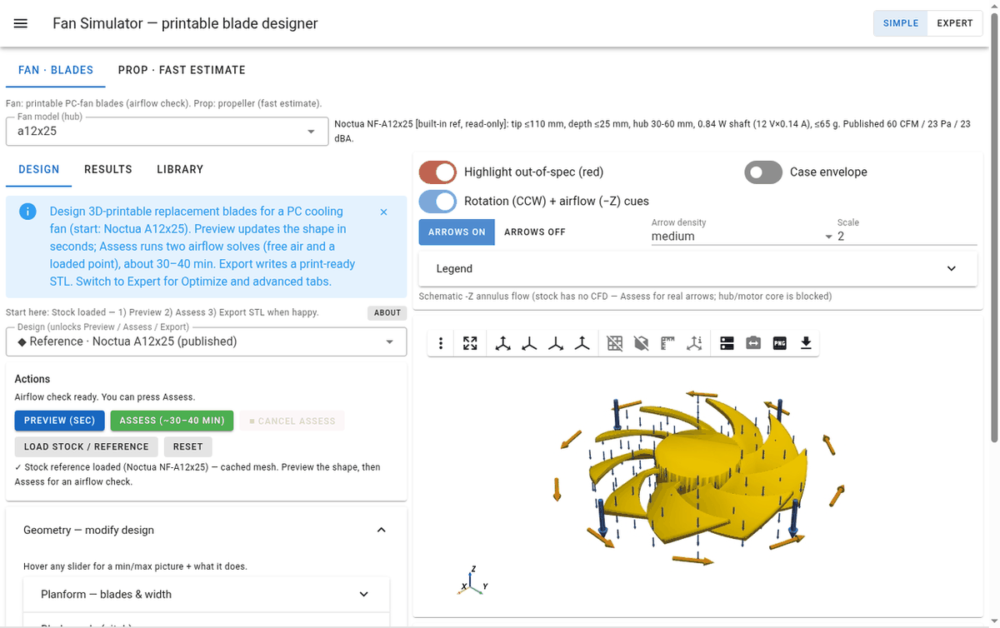

**After (Home start page on launch — 4 clear choices, workflow, validated vs experimental):**

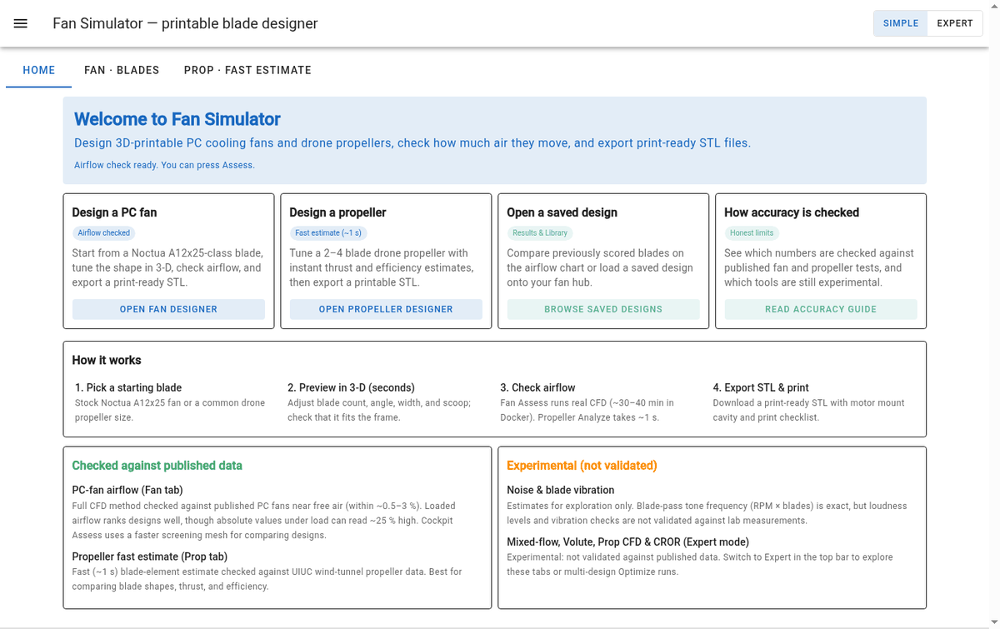

**After ("How accuracy is checked" expanded with inline SVG concept diagrams):**

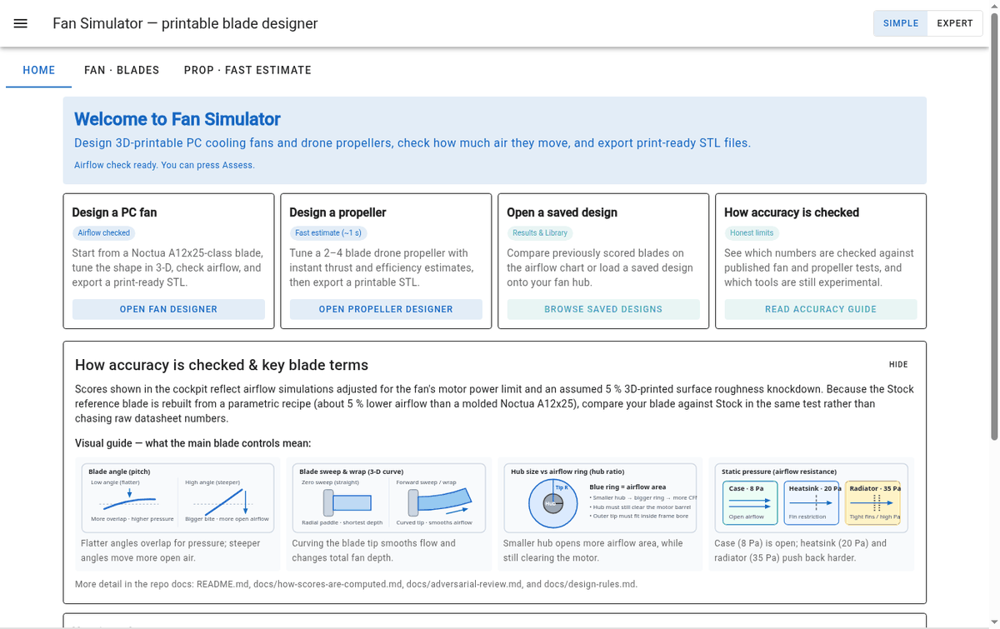

---

### 2. Fan Design & Visual Guide (Simple Mode)

**After (clicked "Open Fan designer" from Home — friendly model name, concise summary, clean 3-D viewer controls, immediate 3-D render):**

**After (Visual guide & Assess settings expanded inside Fan Design):**

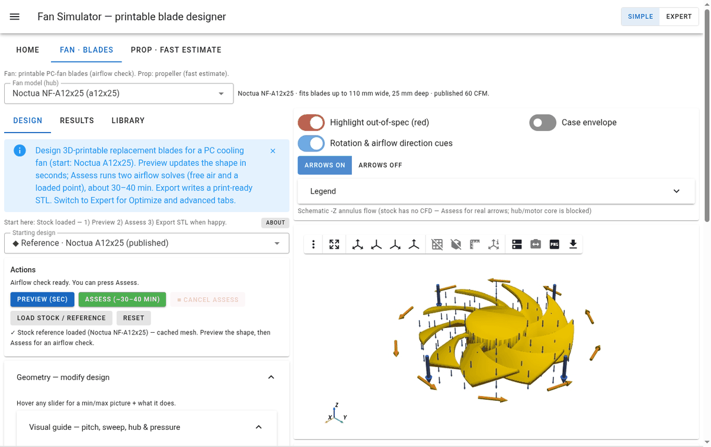

---

### 3. Fan Library (Simple Mode)

**Before (leaked `Stock reference loaded…`, disabled `Scale to this hub` when empty):**

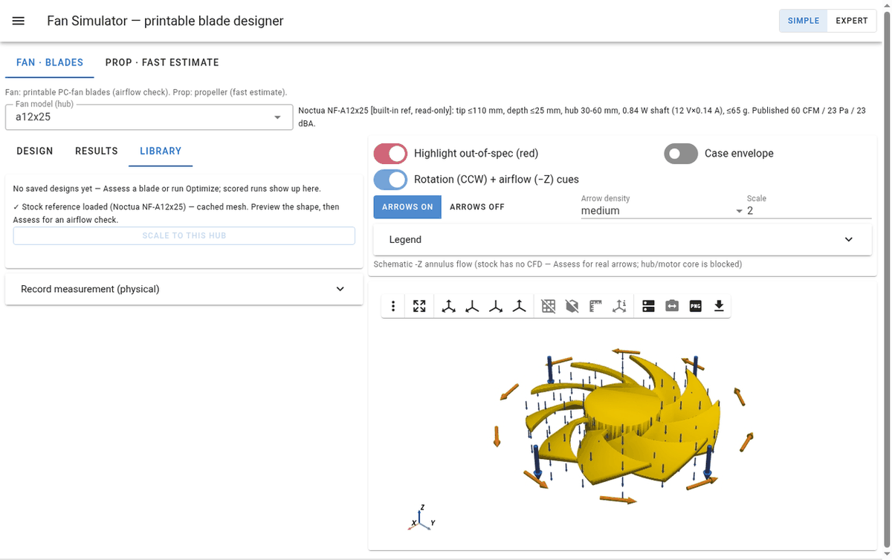

**After (clean empty state, scrollable list container when populated):**

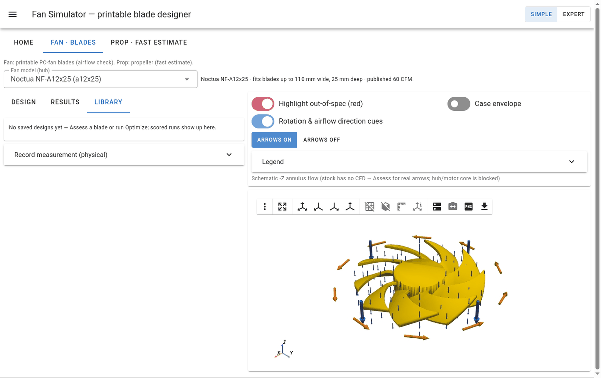

---

### 4. Propeller Design & Results (Simple Mode)

**Before (raw `fpv_5inch`, `Chord (×tip R)` jargon, no hover tooltips, blank 3-D viewer):**

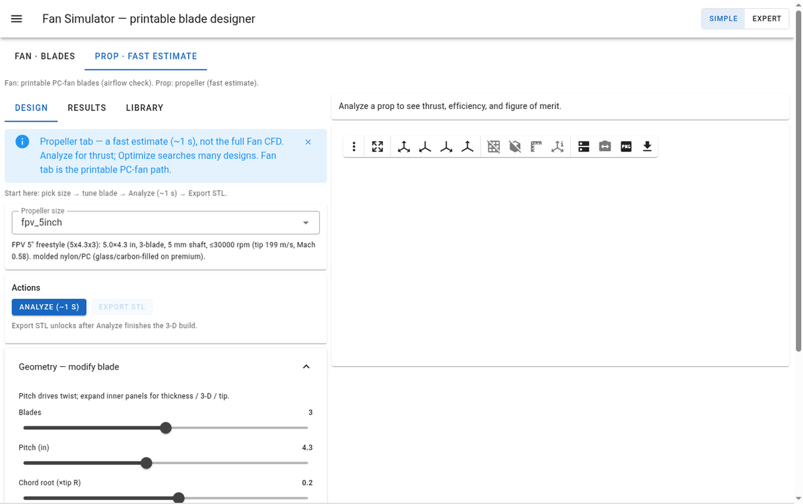

**After (friendly size title, plain `Blade width`, units beside values, hover tooltip + SVG diagram on Pitch, 3-D viewer placeholder):**

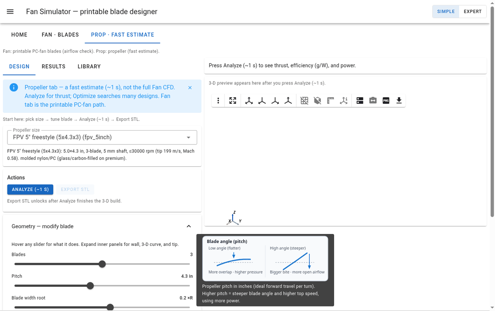

**Before (Prop Results leaked Expert-only `Open-air airflow — top CFD-refined design` card into Simple mode):**

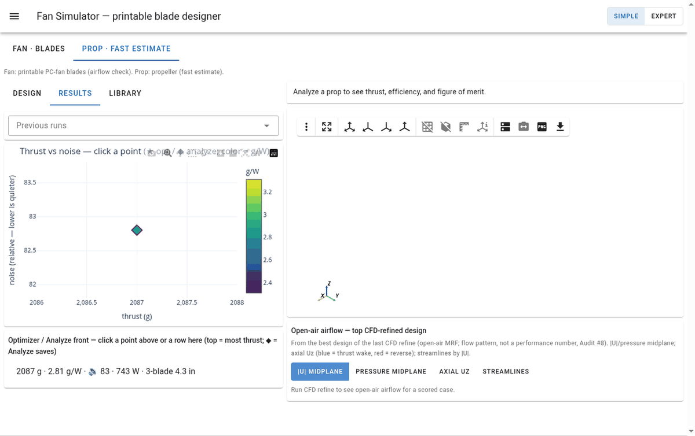

**After (Expert-only CFD card hidden in Simple mode):**

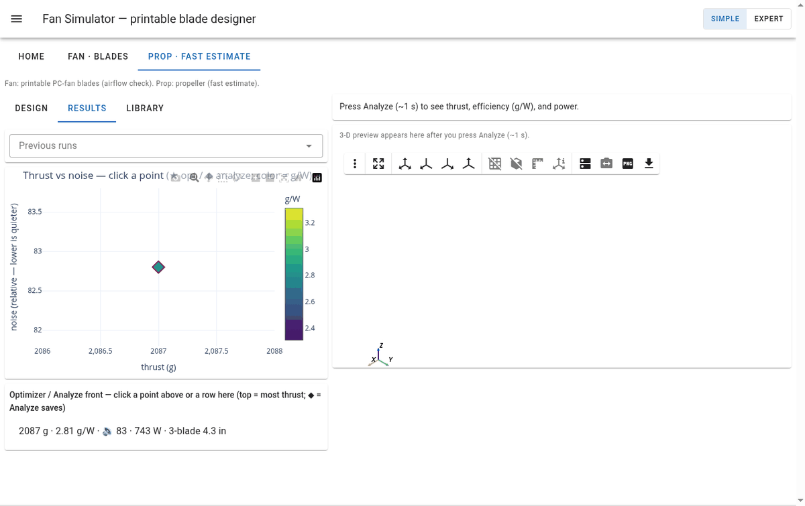

---

### 5. Expert Archetype Tabs (Mixed, Volute, CROR)

**Before (no units beside slider values, no hover tooltips, no explanation for disabled Assess/Export, blank 3-D box, inconsistent Volute checkbox):**

| Mixed (before) | Volute (before) | CROR (before) |
|---|---|---|
| 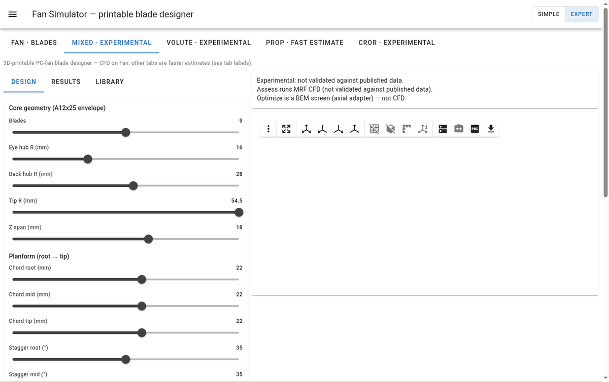 | 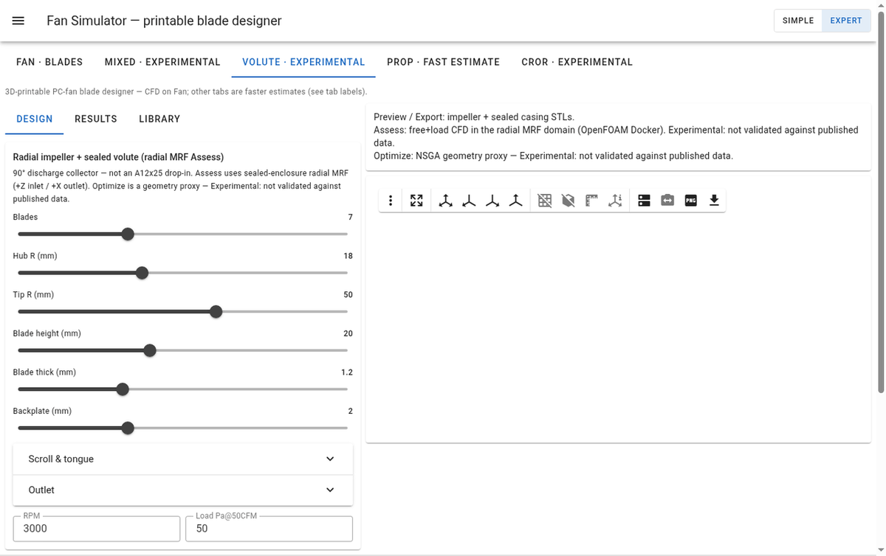 | 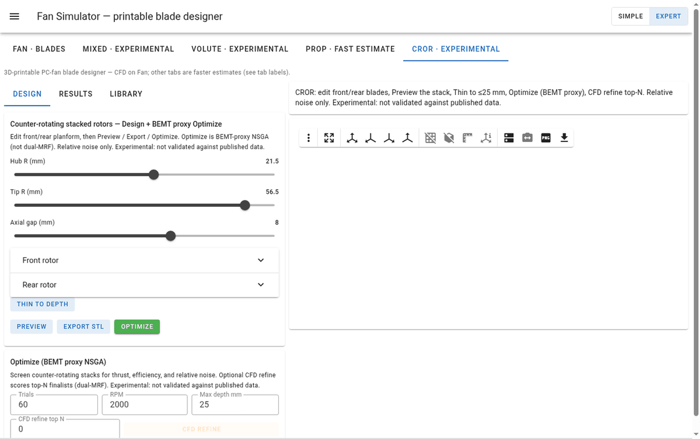 |

**After (units beside values, all tooltips wired, Preview hints for disabled buttons & empty 3-D viewers, consistent `VSwitch` on Volute):**

| Mixed (after) | Volute (after) | CROR (after) |
|---|---|---|
| 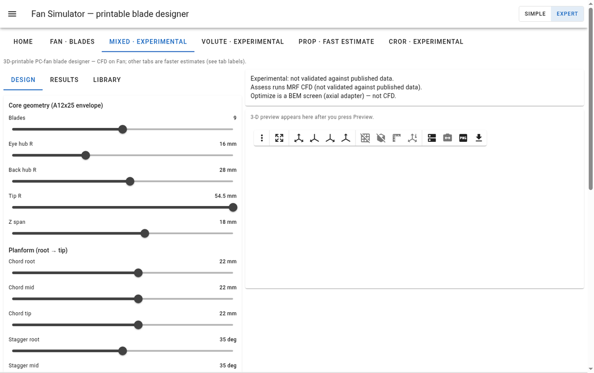 |  | 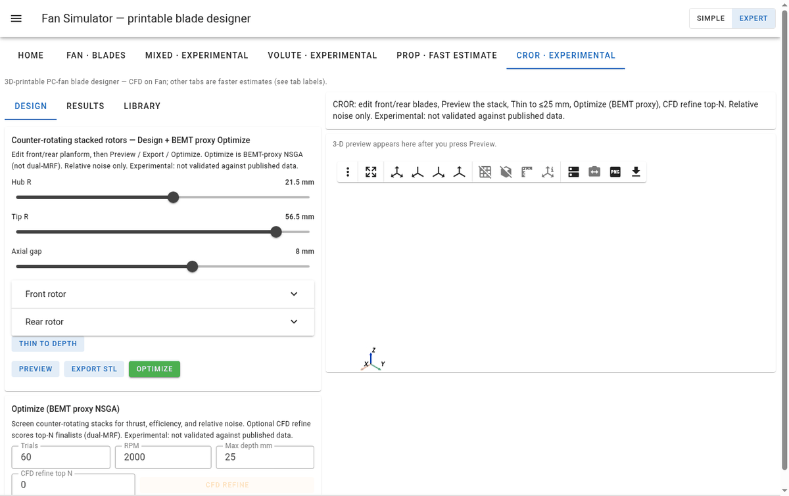 |
